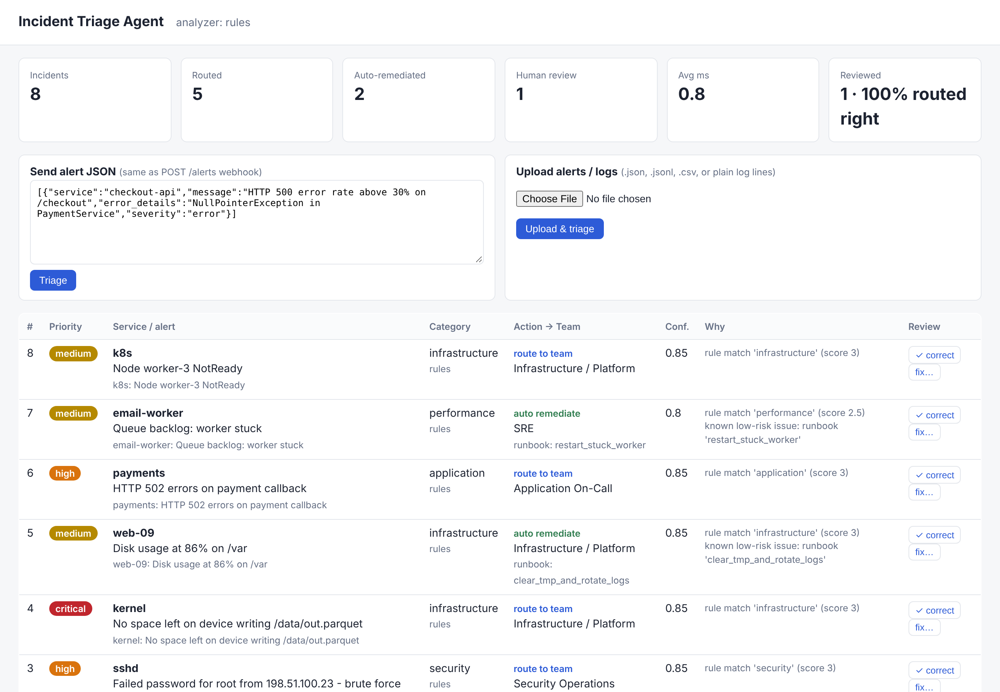

# Incident Triage Agent — Prototype

Automated incident triage: ingest alerts → normalize & de-duplicate → analyze (Claude + rules) →
prioritize → orchestrate (auto-remediate / route to team / human review) → log everything.



**Evidence of execution:** recorded test, evaluation and demo-session output is in [`evidence/`](evidence/README.md).
Regenerate it with `python record_evidence.py`.

## Run it

```bash
pip install -r requirements.txt
python evaluate.py --show-errors        # score against labeled sample alerts (M2.6 criteria)
python -m pytest -q tests               # unit tests
uvicorn app:app --port 8000             # web service + dashboard at http://localhost:8000
```

**Analyzer modes.** If `ANTHROPIC_API_KEY` is set, alerts are analyzed by Claude (`claude-opus-5-5`,
structured JSON output, low effort). Without a key it runs in **rules-only** mode so the demo works offline.
Force a mode with `TRIAGE_ANALYZER=rules|claude`, or `python evaluate.py --analyzer claude`.

## Endpoints

| Method | Path | Purpose |
|---|---|---|
| POST | `/alerts` | Webhook/API: one alert, a list, or a Prometheus Alertmanager envelope |
| POST | `/upload` | Upload `.json`, `.jsonl`, `.csv`, or plain log files |
| GET | `/incidents` | Incident log (every decision, action, reason) |
| POST | `/incidents/{id}/feedback` | Responder marks a decision correct / corrected |
| GET | `/stats` | Totals, action mix, avg latency, accuracy on human-reviewed incidents |


## Current results (rules-only mode, 39 synthetic labeled alerts)

| Metric | Result | Target |
|---|---|---|
| Category accuracy | 97.1% | 90% ✅ |
| Severity accuracy | 48.6% | 90% ❌ |
| Routing accuracy | 97.1% | 95% ✅ |
| Avg processing time | < 1 ms | < 10 s ✅ |
| Critical alerts under-prioritized | 0 | 0 ✅ |
| Duplicates folded | 4/4, 0 false folds | — |

Keyword rules route well but estimate severity poorly (97% are within one level, though).  **Claude mode has not been scored yet as a result of not wanting to pay for the API at this point, however I expect better performance using it**
run `python evaluate.py --analyzer claude` with an API key. The 39 alerts are synthetic and the rules were
written alongside them. Treat these numbers as a smoke test, and validate on real labeled alerts from your
team before quoting accuracy.

## Tuning knobs (env vars)
`TRIAGE_CONFIDENCE_THRESHOLD` (0.6), `TRIAGE_AUTO_MIN_CONFIDENCE` (0.8), `TRIAGE_AUTO_REMEDIATION` (1/0),
`TRIAGE_MODEL` (claude-opus-5-5). Categories, teams, severity floors and runbooks live in `triage/rules.py`.
